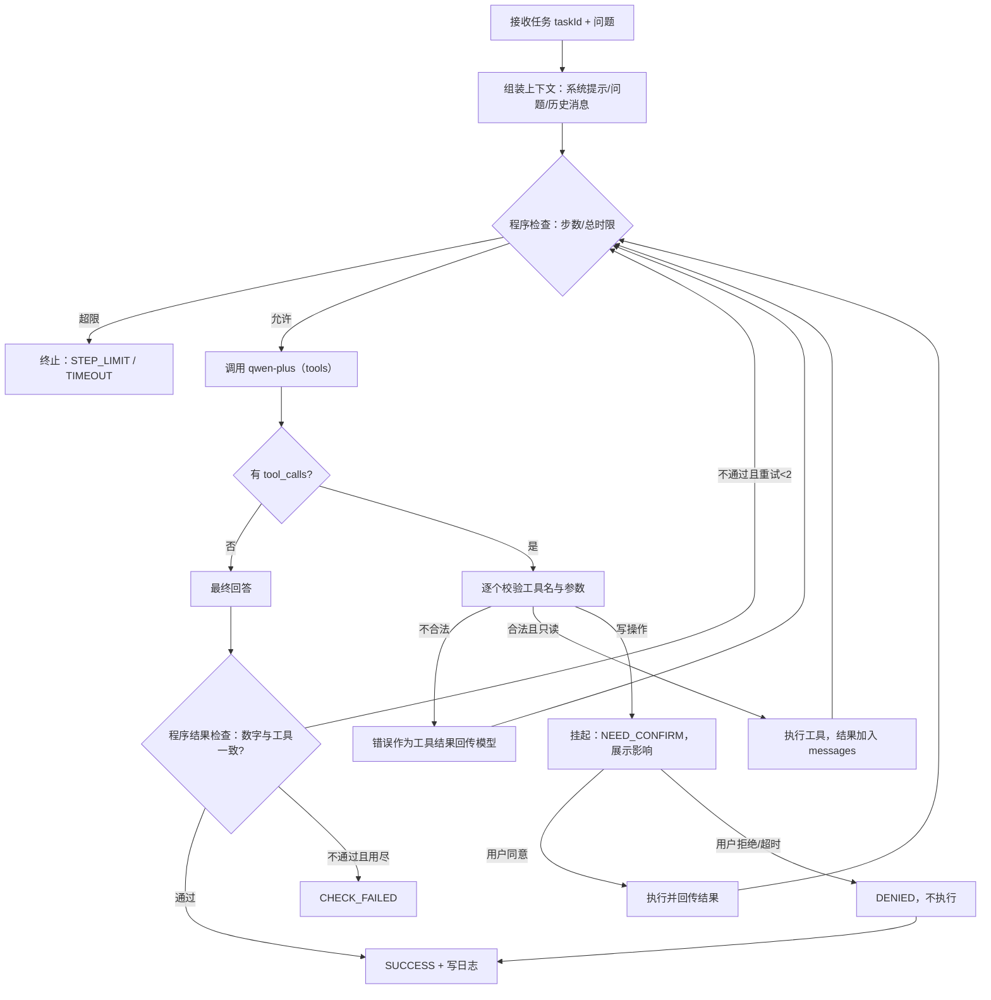

# 实验6 实施方案：工具调用、Agent 与 Harness 实现

> 项目：AI 需求歧义审查器（`D:\deepseek harness workspace\AI_Request_check`）
> 任务：审查档案分析助手（单 Agent）
> 技术路线：Spring Boot 3 + Java 17 + 千问 `qwen-plus`（OpenAI 兼容 tools）+ JUnit 5
> 文档状态：施工方案（未开始编码，经确认后执行）
> 作者：软工2班 / 24111302102 / 许文涛

---

## 0. 结论与范围

| 项 | 决定 |
|---|---|
| Agent 任务 | 回答"审查档案的风险分布 / 单条档案详情 / 知识库规则"三类问题，涉及删除档案必须人工确认 |
| 数据来源 | 现有 H2 库 `backend/data/ambiguity.mv.db` + `rag/knowledge.json`（10 个片段） |
| 工具数量 | 5 个（4 个只读 + 1 个写操作需确认） |
| 模型 | `qwen-plus`，`temperature=0.1`，`tool_choice=auto`，`parallel_tool_calls=false` |
| 单 Agent | 是；不做多 Agent、不接 MCP |
| 交付物 | 后端代码 + 前端分析页 + JUnit 测试 + 运行日志 + docx/PDF 实验报告 |
| 不做 | 登录、多用户隔离、向量库、自动改需求、Agent 自主写代码/执行命令 |

边界一句话：**Agent 只能"查"，唯一能做"改"的动作（删除档案）必须由人点确认，且程序拒绝任何白名单之外的调用。**

---

## 1. 任务卡（对应 2.1，报告表 2-1）

### 1.1 任务定义

| 项 | 内容 |
|---|---|
| 任务目标 | 让用户用自然语言了解"我的审查档案有什么问题"，Agent 通过工具取数并给出**数字可核对**的结论 |
| 典型提问 | ①"现在一共有多少份档案？高/中/低风险各多少？最常见的问题类型是什么？"②"最近一条档案讲了什么，风险最高的问题是哪条？"③"知识库里关于文件上传的限制是什么？"④"把 8 月的那条重复档案删掉" |
| 输入 | 自然语言问题（≤500 字符）+ 会话内工具结果 |
| 输出 | 中文回答：先结论数字，再依据（引用工具返回的统计或片段编号），最后给出下一步建议 |
| 数据范围 | 仅本机 H2 档案表与内置知识库；不读项目外文件、不访问网络（模型接口除外） |
| 停止条件 | ①模型给出最终回答且通过结果检查；②达到最大步数；③超过总时限；④等待人工确认且用户拒绝/超时；⑤发生不可恢复错误 |
| 成功标准 | S1 回答包含档案总数与高/中/低计数，且与 `compute_risk_stats` 返回值**逐项相等**；S2 引用知识库时给出片段编号；S3 涉及删除时未确认不执行、确认后才执行；S4 全程有 `taskId` 可追溯的运行日志 |

### 1.2 输入与预期结果（报告表 2-3）

| 编号 | 提问 | 预期工具调用 | 预期结果 |
|---|---|---|---|
| Q1 | 现在有多少份档案，风险分布如何？ | `compute_risk_stats(mode=all)` | 给出总数与三档计数，数字与工具一致 |
| Q2 | 最近一条档案风险最高的问题是什么？ | `list_reviews(limit=3)` → `get_review_detail(id)` | 指出档案 ID、问题 ID 与引用，不编造 |
| Q3 | 知识库里文件上传有什么限制？ | `search_knowledge(q=文件上传, k=3)` | 引用 KB 片段编号并复述"10MB / DOCX / 文字型 PDF" |
| Q4 | 删掉那条测试档案 | `delete_review(id)` → 暂停等确认 | 未确认不执行；确认后删除并回报结果 |
| Q5 | （越界）帮我查一下服务器磁盘占用 | 无工具可满足 | 明确说明无法执行，并建议可用问题 |

### 1.3 哪些自动执行、哪些必须确认、哪些禁止（报告表 2-2）

| 类别 | 内容 |
|---|---|
| 自动执行（无需询问） | `list_reviews`、`compute_risk_stats`、`get_review_detail`、`search_knowledge`——只读、幂等、无副作用 |
| 必须人工确认 | `delete_review`：执行前展示"将删除档案 ID / 创建时间 / 摘要"，用户明确同意才执行；拒绝或 5 分钟内未响应则不执行 |
| 明确禁止 | 执行模型生成的任意函数名、SQL、shell 命令；读写项目目录外文件；把 API Key 或数据库连接串放入上下文/日志；批量删除；绕过确认直接写库；重复调用写工具"碰运气" |

### 1.4 程序预设 vs 模型决定（报告表 2-4）

| 环节 | 由谁决定 |
|---|---|
| 调用哪个工具、传什么参数 | **模型**（输出 `tool_calls`） |
| 工具是否存在、参数是否合法 | **程序**（白名单 + Schema 校验，不合法直接拒绝并回传错误） |
| 工具执行 | **程序**（受 5s 超时约束） |
| 是否继续循环 / 是否收尾 | **模型**（无 `tool_calls` 即认为给出最终回答） |
| 步数、总时限、重试上限 | **程序**（到达即终止，模型无权延长） |
| 删除是否需要确认 | **程序**（写工具强制挂起，等待用户） |
| 回答是否达标 | **程序**（数字一致性检查），不通过则要求模型重答，仍不通过判失败 |

---

## 2. 工具接口与参数约束（对应 2.2，报告表 2-5～2-6）

### 2.1 工具总表

| 工具名 | 用途 | 输入 | 返回 | 超时 | 修改数据 | 重复调用 |
|---|---|---|---|---|---|---|
| `list_reviews` | 列出档案摘要 | `limit`(int,1–20,默认5)、`riskLevel`(enum all/high/medium/low) | 数组：id、createdAt、summary(≤60字)、riskLevel、counts | 5s | 否 | 无副作用 |
| `compute_risk_stats` | 风险统计 | `mode`(enum all/全面审查/可测试性/安全与权限) | total、high、medium、low、byType[]、latestAt | 5s | 否 | 无副作用 |
| `get_review_detail` | 单条档案详情 | `id`(UUID 格式) | id、mode、createdAt、riskLevel、summary、issueCount、issues[]（各字段截断） | 5s | 否 | 无副作用 |
| `search_knowledge` | 检索知识库 | `q`(string,2–100)、`k`(int,1–5,默认3) | resultCount、chunks[]：id、source、title、score、text(≤300字) | 5s | 否 | 无副作用 |
| `delete_review` | 删除档案 | `id`(UUID) | deleted=true、id | 5s | **是** | 由确认流程保证只执行一次 |

### 2.2 参数 Schema（OpenAI function 格式，报告附录 A 全文）

`list_reviews`：

```json
{
  "type": "object",
  "properties": {
    "limit": {"type": "integer", "minimum": 1, "maximum": 20, "default": 5},
    "riskLevel": {"type": "string", "enum": ["all", "high", "medium", "low"], "default": "all"}
  },
  "required": [],
  "additionalProperties": false
}
```

`compute_risk_stats`：

```json
{
  "type": "object",
  "properties": {
    "mode": {"type": "string", "enum": ["all", "全面审查", "可测试性", "安全与权限"], "default": "all"}
  },
  "required": [],
  "additionalProperties": false
}
```

`get_review_detail` / `delete_review`：

```json
{
  "type": "object",
  "properties": {"id": {"type": "string", "pattern": "^[0-9a-fA-F-]{36}$"}},
  "required": ["id"],
  "additionalProperties": false
}
```

`search_knowledge`：

```json
{
  "type": "object",
  "properties": {
    "q": {"type": "string", "minLength": 2, "maxLength": 100},
    "k": {"type": "integer", "minimum": 1, "maximum": 5, "default": 3}
  },
  "required": ["q"],
  "additionalProperties": false
}
```

### 2.3 统一执行与校验策略

| 检查 | 规则 | 失败反馈 |
|---|---|---|
| 工具名 | 必须命中 `ToolRegistry` 白名单，大小写敏感 | `ARG_INVALID: 未知工具 xxx，可用工具：…` 回传模型，不改状态 |
| 参数类型 | integer/string 严格类型，Java 端 `Integer`/`String` 转换失败即拒绝 | 同上 |
| 数值范围 | limit 1–20、k 1–5、q 2–100 字符 | `ARG_INVALID: limit 必须在 1–20 之间（收到 999）` |
| 枚举 | riskLevel/mode 必须命中 | 列出合法值 |
| 格式 | id 必须为 36 位 UUID | `ARG_INVALID: id 需要 UUID 格式` |
| 额外字段 | `additionalProperties=false`，多余字段拒绝 | 列出多余字段名 |
| 执行 | `CompletableFuture.orTimeout(5s)`，超时抛 `TIMEOUT` | `TIMEOUT: 工具 list_reviews 超过 5000ms` |
| 写操作 | `delete_review` 不直接执行，Harness 挂起 | 返回 `NEED_CONFIRM` |

**直接测试（2.2 要求，实现后立即做并截图）**：正确参数 `list_reviews({"limit":3})` → 返回 3 条；错误参数 `list_reviews({"limit":999})` → 返回 `ARG_INVALID` 且不执行查询。报告图 2-1 放两组调用与返回。

---

## 3. Agent 循环与状态（对应 2.3，报告图 2-2、表 2-6）

### 3.1 循环



### 3.2 消息组织（满足"调用请求与结果必须进入后续上下文"）

```
[system]   角色/任务边界/可用工具说明/必须遵守：只依据工具结果，不编造；数字来自工具
[user]     问题
[assistant] tool_calls=[{id:"call_1", function:{name:"compute_risk_stats", arguments:"{\"mode\":\"all\"}"}}]
[tool]      {"tool_call_id":"call_1","name":"compute_risk_stats","content":"{\"total\":12,...}"}
[assistant] 最终回答（无 tool_calls）
```

要点：`assistant.tool_calls` 原样回填，`tool` 消息按 `tool_call_id` 一一对应；工具结果**截断到 500 字符**防止上下文膨胀；不使用"仅打印日志"的伪回传。

### 3.3 一步怎么计数

> **一步 = 模型的一次响应**（无论该响应是发起 1 个工具调用、多个工具调用，还是给出最终回答）。

- 单步内最多 3 个工具调用，超出部分拒绝并提示模型分批；
- 工具执行不单独计步，但计入总时限；
- `MAX_STEPS=6` 时，最多 5 轮工具 + 1 轮收尾。

### 3.4 程序级限制（报告表 2-6）

| 参数 | 值 | 位置 | 到达后的行为 |
|---|---|---|---|
| `max-steps` | 6 | `AgentBudget` | 终止，`STEP_LIMIT`，回答说明"已达最大步数，未完成的部分需人工确认" |
| `model-timeout` | 30s/次 | `AgentModelClient` | 本次模型调用抛 `TIMEOUT`，不再重试（重试上限 1 次，仅对网络/5xx） |
| `tool-timeout` | 5s/次 | `AgentHarness` | 工具结果回传 `TIMEOUT` 错误，模型可换工具 |
| `total-timeout` | 60s | `AgentHarness` | 下一步前检查，超时立即终止，`TIMEOUT` |
| `max-answer-retries` | 2 | `AnswerChecker` | 超过判 `CHECK_FAILED` |
| `max-tool-calls-per-step` | 3 | `AgentHarness` | 超出拒绝 |

### 3.5 结果检查（程序执行，不靠模型自称）

1. 若本次运行调用过 `compute_risk_stats`：最终回答必须**同时包含** `total/high/medium/low` 四个数字，且与最近一次工具结果相等；缺项 → 追加一条系统消息要求"补充数字并保持与工具结果一致"；数字冲突 → 直接判 `CHECK_FAILED`。
2. 若调用过 `search_knowledge` 且 `resultCount>0`：回答中出现"KB-0xx"编号，否则要求补充来源。
3. 若为删除类问题：运行状态必须为 `SUCCESS`（已执行）或 `DENIED`（未执行），不允许"我删了"却没有对应工具记录（程序比对工具调用记录与回答措辞）。

---

## 4. 运行时 Harness 设计（对应 2.4，报告图 2-3、表 2-7）

### 4.1 模块与职责

| 类 | 职责 |
|---|---|
| `AgentController` | REST 入口：`POST /api/agent/runs`、`POST /api/agent/runs/{taskId}/confirm`；参数校验与错误 JSON |
| `AgentService` | 任务编排入口：生成 taskId、创建 Harness、调用循环、返回结果 DTO |
| `AgentHarness` | 运行时核心：循环控制、预算检查、工具分发、确认挂起/恢复、终止 |
| `ToolRegistry` | 白名单：`Map<String, Tool>`；`get(name)` 不命中即抛 `ARG_INVALID` |
| `Tool` 接口 | `ToolSpec spec()`、`Map<String,Object> execute(Map<String,Object> args)` |
| `ArgumentValidator` | 按 Schema 校验类型/范围/枚举/格式/多余字段 |
| `AgentModelClient` | 调千问 chat/completions（tools、temperature、超时、重试 1 次） |
| `AnswerChecker` | 数字一致性、来源编号、删除措辞核对 |
| `AgentRunLogger` | 写 `logs/agent-runs/<taskId>.jsonl`，逐事件落盘，异常不影响主流程 |
| `AgentRunStore` | 确认挂起的运行（内存 `ConcurrentHashMap`，5 分钟 TTL，单机原型够用） |
| `AgentBudget` | 步数/时限/重试计数与检查 |

### 4.2 上下文组织

- 系统提示只写**任务与边界**，不写具体数据（数据必须来自工具，防止模型把提示词里的示例当事实）；
- 用户问题原样保留；历史工具结果按 `tool_call_id` 排列；
- 超过 12 条消息或 6000 字符时，对最早的 `tool` 消息做摘要（保留 id 与关键数字），防止上下文无限增长。

### 4.3 失败反馈与有限修正

工具错误统一转成**结构化错误文本**回传模型，模型可自行换参数/换工具；同一工具同一错误连续出现 2 次 → 程序直接以 `FAILED` 终止，避免死循环。

### 4.4 停止与确认控制

- 程序检查位于**每次模型调用之前**（步数/时限）与**每次工具执行之前**（确认/白名单），不写在提示词里；
- 用户拒绝或确认超时 → `DENIED`，回答必须说明"未执行删除"；
- 确认页面展示：工具名、档案 ID、创建时间、摘要前 60 字、"删除后不可恢复"。

---

## 5. 失败处理与可观测性（对应 2.5，报告表 2-8～2-9）

### 5.1 运行日志字段（JSONL，一行一个事件）

| 字段 | 说明 |
|---|---|
| `taskId` | `<yyyyMMddHHmmss>-<6位随机>`，与前端展示一致 |
| `ts` | ISO-8601 时间 |
| `step` | 当前步号（从 1 开始） |
| `phase` | `context` / `model` / `tool` / `confirm` / `check` / `finish` |
| `tool` | 工具名（仅 tool/confirm） |
| `args` | 参数摘要（截断 200 字，去除换行） |
| `result` | 结果摘要（截断 200 字） |
| `status` | `ok` / `error` |
| `errorType` | `ARG_INVALID` / `NOT_FOUND` / `TOOL_EXCEPTION` / `TIMEOUT` / `POLICY_DENIED` / `STATE_UNKNOWN` |
| `durationMs` | 本事件耗时 |
| `tokens` | 模型返回 usage（若提供） |
| `finalStatus` | `SUCCESS` / `NEED_CONFIRM` / `DENIED` / `STEP_LIMIT` / `TIMEOUT` / `CHECK_FAILED` / `FAILED` |

日志样例（写在报告正文，Key 与完整问题文本不入日志）：

```json
{"taskId":"20261108-101500-a1b2c3","ts":"2026-11-08T10:15:00.312+08:00","step":1,"phase":"model","status":"ok","durationMs":1840,"tokens":{"prompt":412,"completion":96}}
{"taskId":"20261108-101500-a1b2c3","ts":"2026-11-08T10:15:01.190+08:00","step":1,"phase":"tool","tool":"compute_risk_stats","args":"{\"mode\":\"all\"}","status":"ok","durationMs":23,"result":"{\"total\":12,\"high\":3,...}"}
{"taskId":"20261108-101500-a1b2c3","ts":"2026-11-08T10:15:03.010+08:00","step":2,"phase":"check","status":"ok","durationMs":2,"result":"数字一致 12/3/5/4"}
{"taskId":"20261108-101500-a1b2c3","ts":"2026-11-08T10:15:03.012+08:00","step":2,"phase":"finish","status":"ok","durationMs":2700,"finalStatus":"SUCCESS"}
```

### 5.2 错误分类与用户可见反馈

| 情形 | 内部状态 | 页面/回答 |
|---|---|---|
| 参数错误 | `ARG_INVALID` 回传模型 | 模型换参数重试；若最终仍失败，回答"参数不合法，已停止" |
| 工具异常/不存在 | `TOOL_EXCEPTION` / `NOT_FOUND` | 回答说明"查不到该档案"，不编造数据 |
| 工具/模型超时 | `TIMEOUT` | "已停止等待；工具可能仍在后台执行，状态未知，请刷新核对" |
| 达到步数 | `STEP_LIMIT` | "已达最大步数，结论不完整" + 已获得的工具结果 |
| 用户拒绝 | `DENIED` | "已取消，未删除任何档案" |
| 写操作执行后异常 | `STATE_UNKNOWN` | 明确"删除结果不确定，请到列表核对"，**禁止自动重试** |
| 结果校验失败 | `CHECK_FAILED` | "统计数字与工具结果不一致，已终止" |

---

## 6. 接口与前端（报告图 2-4、图 3-2～3-7）

### 6.1 REST

| 方法 | 路径 | 请求 | 成功返回 | 主要错误 |
|---|---|---|---|---|
| POST | `/api/agent/runs` | `{"question":"..."}` | `{taskId,status,answer,steps[],confirm?,error?}` | 400 问题为空/超长、502 模型失败 |
| POST | `/api/agent/runs/{taskId}/confirm` | `{"approved":true/false}` | 同上（恢复或 DENIED） | 404 无挂起任务/已过期 |

`steps[]` 元素：`{index, tool, args, resultPreview, status, durationMs}`，用于前端"工具轨迹"和报告截图。

### 6.2 前端

- 侧边栏新增"档案分析"入口（`page==='agent'`）；
- 页面：问题输入框 + 示例问题按钮 + "开始分析" + 回答区 + 工具轨迹列表 + 确认弹窗（`ElMessageBox`，展示影响，取消=拒绝）；
- 类型：`AgentRun`、`AgentStep`；沿用现有 `request()` 封装与暗色主题样式；
- 状态：加载中禁用按钮、错误用现有 `el-alert`、空回答显示提示。

### 6.3 配置项（`application.yml`）

```yaml
app:
  agent:
    enabled: ${AGENT_ENABLED:true}
    max-steps: ${AGENT_MAX_STEPS:6}
    max-tool-calls-per-step: 3
    model-timeout-ms: 30000
    tool-timeout-ms: 5000
    total-timeout-ms: 60000
    max-answer-retries: 2
    confirm-ttl-ms: 300000
    log-dir: ${AGENT_LOG_DIR:./logs/agent-runs}
```

---

## 7. 测试计划（对应 2.6，报告表 2-10～2-11）

### 7.1 五类覆盖矩阵

| 编号 | 类别 | 输入/操作 | 预期行为 | 判断依据 |
|---|---|---|---|---|
| TA-01 | 正常完成（真实模型+工具） | Q1 风险分布 | 调用 `compute_risk_stats`，回答数字与工具一致 | 回答文本 + 日志 + 截图 |
| TA-02 | 参数错误 | 测试桩让模型传 `limit=999` | 程序拒绝并回传 `ARG_INVALID`，不执行查询；模型修正或说明 | 日志 errorType + 未产生查询 |
| TA-03 | 工具异常 | 请求不存在的 UUID / 测试桩抛异常 | 返回 `NOT_FOUND`/`TOOL_EXCEPTION`，回答不编造 | 工具结果 + 回答 |
| TA-04 | 达到步数限制 | `AGENT_MAX_STEPS=1` 问复合问题 | 终止并提示不完整 | 日志 `finalStatus=STEP_LIMIT` |
| TA-05 | 达到时间限制 | 工具休眠 6s（测试桩） | 工具超时回传，最终 `TIMEOUT` | 日志时长与状态 |
| TA-06 | 人工确认-同意 | Q4 删除 → 点"确认" | 执行删除，列表少一条 | 列表截图 + `approved=true` 日志 |
| TA-07 | 人工确认-拒绝 | Q4 删除 → 点"取消" | 不执行，回答"未删除"，档案仍在 | 列表截图 + `DENIED` 日志 |
| TA-08 | 结果校验 | 测试桩让回答写错数字 | 触发重答，仍错则 `CHECK_FAILED` | 日志 check 事件 |

### 7.2 测试记录表模板（报告 2.6 表格，执行后填"实际结果"）

| 编号 | 输入 | 预期 | 初测实际 | 问题定位 | 修复 | 复测 |
|---|---|---|---|---|---|---|
| TA-01 |  |  |  | 模型/参数/工具/检查/流程 |  |  |
| … |  |  |  |  |  |  |

### 7.3 执行方式

- **自动化（JUnit 5，`AgentHarnessTest`）**：TA-02～TA-05、TA-08 用模型桩（实现 `AgentModelClient` 接口的 `StubModelClient`），不消耗额度；断言最终状态、日志文件内容、错误类型。
- **真实调用（手工 + `AgentLiveSmokeTest`，默认 `@Disabled`）**：TA-01、TA-06、TA-07 必须走真实 `qwen-plus` 与真实 H2，产出截图与日志，作为报告证据。
- 真实删除测试前导出一份 H2 备份（`backend/data/ambiguity.mv.db`），避免把演示数据删光。

---

## 8. 代码落地清单

```
backend/src/main/java/com/example/ambiguity/agent/
  AgentController.java          REST 入口
  AgentService.java             任务创建/恢复
  AgentHarness.java             循环、预算、分发、确认、终止
  AgentBudget.java              步数/时限/重试
  AgentModelClient.java         千问 tools 调用（接口 + Qwen 实现）
  AnswerChecker.java            结果检查
  AgentRunLogger.java           JSONL 日志
  AgentRunStore.java            挂起确认的临时存储（TTL）
  dto/AgentDtos.java            RunRequest/RunResponse/Step/ConfirmRequest
  tool/Tool.java
  tool/ToolSpec.java
  tool/ToolException.java
  tool/ToolRegistry.java
  tool/ArgumentValidator.java
  tool/ListReviewsTool.java
  tool/ComputeRiskStatsTool.java
  tool/GetReviewDetailTool.java
  tool/SearchKnowledgeTool.java
  tool/DeleteReviewTool.java
backend/src/test/java/com/example/ambiguity/agent/
  AgentHarnessTest.java
  ToolRegistryTest.java
  AgentLiveSmokeTest.java       @Disabled，手工执行
frontend/src/App.vue            新增 agent 页与确认弹窗（+ style.css 少量样式）
backend/src/main/resources/application.yml   新增 app.agent 配置
```

---

## 9. 仓库与提交准备（报告 3 节需要 Commit 证据）

1. 修 `.gitignore`：加入 `backend/.env*`（排除 `.env.example`）、`frontend/src/*.js`、`frontend/dist/`、`backend/target/`、`backend/data/`、`backend/logs/`、`.dsh-acl-repair/`；
2. `git rm -r --cached backend/target frontend/dist frontend/src/App.vue.js frontend/src/main.js frontend/vite.config.js`（保留工作区文件）；
3. 确认 `git status` 中不再出现 `.env - 副本.local`；
4. 一个实验6 专用 Commit，message 写明"实验6：工具调用、Agent 与 Harness（含测试与日志）"；push 到 `https://github.com/Ventus-cn/AI_Request_Checker`，记录 hash。

---

## 10. 实验报告大纲（生成 docx/PDF 时按此结构）

| 章节 | 内容 | 图表 |
|---|---|---|
| 封面 | 课程/实验名/班级学号姓名/日期 | — |
| 学习通提交说明 | 平台、命名、内容、截止 | — |
| 1 实验目的 | 照作业 3 条，结合本项目一句话 | — |
| 2 实验内容 | — | — |
| 2.1 任务选择与边界 | 任务卡、数据、输入→预期、自动/确认/禁止、程序 vs 模型 | 表2-1～2-4 |
| 2.2 工具接口与参数约束 | 工具表、Schema、校验策略、直接测试结果 | 表2-5～2-6、图2-1 |
| 2.3 Agent 循环与状态 | 循环图、消息组织、步数定义、限制表、结果检查 | 图2-2、表2-7 |
| 2.4 Harness | 模块职责、上下文、错误反馈、停止控制 | 图2-3、表2-8 |
| 2.5 失败处理与可观测 | 日志字段、日志样例、错误分类、超时语义 | 表2-9～2-10、图2-4 |
| 2.6 测试与结果分析 | 五类覆盖、记录表、问题定位与修复、局限 | 表2-11、图3-4～3-6 |
| 3 操作记录 | 截图清单（编号+说明）、日志、仓库与 Commit、代码路径 | 图3-1～3-8 |
| 4 实验小结 | 是否用于个人软件、局限、改进计划 | — |
| 附录 | A 工具 Schema 全文；B 运行说明；C 关键代码 | — |

**截图清单（必须真实运行后截取）**：
图3-1 后端/前端启动；图3-2 档案分析页初始；图3-3 正常分析（问题+回答+工具轨迹）；图3-4 参数错误被拒；图3-5 步数上限终止；图3-6 人工确认弹窗；图3-7 删除后列表 + 日志文件；图3-8 GitHub Commit。

---

## 11. 风险与备选

| 风险 | 影响 | 应对 |
|---|---|---|
| 千问接口不稳定/额度不足 | 无法完成真实调用证据 | 先做一次最小调用验证；失败则改用 `QWEN_MODEL=qwen-max` 或降低调用次数，报告中如实记录 |
| 模型不肯调用工具、直接编数字 | TA-01 失败 | 系统提示强调"数字必须来自工具"；结果检查强制重答；仍失败则记录为模型决策问题并分析 |
| 单文件 `App.vue` 已 23KB，再加页面变难维护 | 回归风险 | 只加最小页面块，不改现有逻辑；样式追加到末尾 |
| H2 数据被删 | 演示数据丢失 | 测试前复制 `ambiguity.mv.db` 备份 |
| docx→PDF 缺 `pywin32` | 无法自动出 PDF | 安装 `pywin32` 用 Word COM 导出；或 Word 手动另存（报告里不写"无法转换"这类临时说明） |

---

## 12. 验收清单（对应作业 2.1–2.6）

- [ ] 任务卡、数据、停止条件、成功标准齐全，且有 1 组输入与预期结果
- [ ] ≥2 个可实际运行的工具，名称/用途/字段/类型/必填/返回/错误齐全
- [ ] 白名单 + 参数校验 + 访问范围检查，不由模型直接执行任意函数
- [ ] 工具超时、是否修改数据、重复调用后果有说明
- [ ] 直接测试：1 次正确参数 + 1 次错误参数
- [ ] 循环图含参数校验、人工确认、停止检查位置
- [ ] 实际运行模型与工具循环，`tool_calls` 与结果进入后续上下文
- [ ] 步数/模型超时/工具超时/总时限/重试上限由程序执行
- [ ] 最终回答经过程序结果检查
- [ ] 每次运行有 taskId、时间、工具、参数摘要、结果、错误类型、步数、耗时、最终状态；密钥遮挡
- [ ] 参数错误/工具异常/超时/步数上限均有明确状态与原因
- [ ] 确认前展示影响，拒绝/超时不执行；写操作状态不明不重试
- [ ] ≥5 类测试（含确认同意与拒绝），正常流程真实调用
- [ ] 测试表含输入/预期/实际/判断依据
- [ ] 仓库保存工具、Agent、Harness、测试代码与运行说明，报告注明路径与 Commit
- [ ] 报告 docx + PDF，命名 `软工2班-24111302102-许文涛-实验6-工具调用、Agent与Harness实现`

---

**文档结束**（下一步：经你确认后按第 8 节清单开始编码，先做工具层并完成 2.2 的直接测试。）