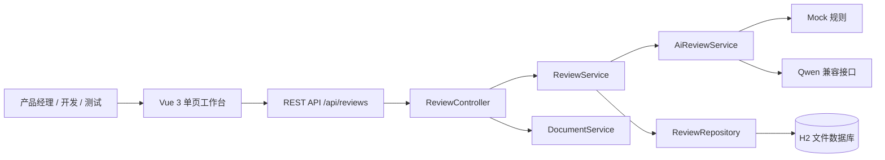
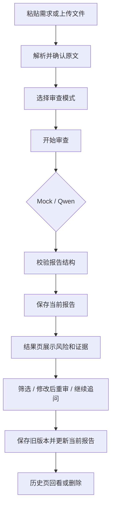

# AI 需求歧义审查器

## 软件设计说明书

**文档版本：** V1.0  
**适用版本：** 测试修订版 V1.1  
**编写日期：** 2026-10-20  
**文档状态：** 设计与实现对照稿

> 本文档根据《需求规格书.md》、项目现有 Vue 前端、Spring Boot 后端、README 和已实现的接口整理。需求规格书中的“必须”属于产品验收约束；本文档负责说明系统如何组织、呈现和落地这些能力，不把附件中的内容当作本次用户请求之外的额外指令。

---

## 1. 设计目标与范围

### 1.1 设计目标

系统是一张面向需求评审的本地工作台。它将一段需求原文转换成可追溯的审查证据，帮助产品、开发和测试人员快速回答三个问题：

1. 需求中哪里存在不清楚或不可验收的表达？
2. 哪些问题会带来权限、安全、边界或返工风险？
3. 下一步需要确认什么，以及如何写成可测试的验收口径？

界面设计采用“编辑台 + 证据档案”的产品隐喻：输入页强调专注和确认，报告页强调证据分层，历史页强调回看和版本轨迹。视觉风格保持克制、专业、有纸张和档案感，避免大面积渐变、聊天气泡和模板化 AI 视觉。

### 1.2 本次设计覆盖

- 桌面端和窄屏端的整体布局、导航和视觉规范；
- 新建审查、审查报告、审查档案三个逻辑页面；
- 文本输入、Word/PDF 解析、审查模式、报告筛选、追问、版本和删除等功能模块；
- 加载、空数据、校验失败、网络失败、AI 失败和筛选无结果等状态；
- 前端视图与 REST 接口、报告字段、后端服务的对应关系；
- 可访问性、隐私、安全和可维护性要求。

### 1.3 现有实现基线

| 层次 | 当前实现 | 设计约束 |
|---|---|---|
| 前端 | Vue 3 + TypeScript + Vite + Element Plus + lucide-vue-next | 保持组件轻量，优先复用现有 Element Plus 表单能力 |
| 页面状态 | `App.vue` 中的 `review`、`result`、`history` 三种视图状态 | 逻辑页面保持清晰，可在后续迭代替换为路由 |
| 后端 | Spring Boot 3 + Java 17 + REST Controller/Service/Repository | 业务校验和 AI 输出校验放在后端，浏览器不接触 API Key |
| 数据 | H2 文件数据库，保存原文、模式、当前报告和 `versions` | 历史档案按创建时间倒序展示 |
| AI | Mock 默认可运行，可选 Qwen 兼容接口 | Mock 模式必须能完成完整演示闭环 |
| 文档解析 | Apache POI 解析 DOCX，PDFBox 解析文字型 PDF | 扫描 PDF 显示无法提取文字，不生成空报告 |

---

## 2. 总体架构设计

### 2.1 分层结构



### 2.2 核心业务闭环



### 2.3 设计原则

1. **原文优先：** 原文是唯一证据源，页面不静默改写用户输入；引用、位置和报告内容必须来自当前审查文本。
2. **证据优先：** 报告卡片先呈现风险和引用，再呈现解释、缺失条件、问题和验收标准。
3. **一步一确认：** 上传只负责解析，不自动发起审查；用户看到提取文本后主动点击开始审查。
4. **失败可恢复：** 错误提示说明原因和下一步，保留用户已经输入的文本，允许重试。
5. **本地可演示：** 不配置 API Key 时，Mock 模式仍能完成输入、报告、追问和历史闭环。

---

## 3. UI 视觉设计系统（参考 SpecLens AI 修订）

### 3.1 参考结论与本项目取舍

SpecLens AI 的公开界面和 README 形成了一条清晰的产品主线：**上传工作区 → 解析/提取 → 审查 Dashboard → 发现项详情 → 报告输出**。它把“健康度/风险摘要”放在结果页首屏，把需求浏览、冲突发现和建议修复放入可继续下钻的工作区，适合参考本项目的结果页信息层级。

本项目采用这条主线的交互逻辑，但按当前实现收敛范围：

| SpecLens AI 的模式 | 本项目的对应设计 | 当前实现边界 |
|---|---|---|
| 上传工作区 | 新建审查页的原文输入 + Word/PDF 导入卡片 | 当前支持单文件和单段文本，不承诺多文档项目 |
| 解析/提取 | 上传后回填可编辑文本，用户确认后开始审查 | `POST /api/reviews/upload` 只解析，不自动调用 AI |
| 健康度摘要 | 报告页的风险等级、风险计数和审查结论 | 当前使用 high/medium/low 计数，不引入未经实现的 0–100 健康分 |
| Findings / Requirements Explorer | 问题类型筛选 + 证据卡片 | 当前以列表筛选为主，不实现冲突图和跨文档关系图 |
| Finding detail | 问题卡片内展开原文、缺失条件、问题和验收标准 | 已由 `Issue` 字段支持 |
| PDF 报告导出 | 设计为后续迭代入口 | 当前不在实现范围内 |

### 3.2 视觉方向

在 SpecLens AI 的“工程审查工作台”基础上，继续使用本项目已有的“安静编辑台”方向：深青色导航、暖白内容纸张、低饱和灰绿背景、琥珀色行动和引用、红/黄/绿风险语义。页面应像一张可回看的审查工作台，而不是聊天页面或营销落地页。

视觉重点从“卡片堆叠”调整为“工作区层次”：

1. 侧边栏固定工作区入口，建立项目工具感；
2. 页面首屏先给出输入/风险概况，再展示可下钻的证据；
3. 结果页通过摘要、筛选和详情三层组织信息；
4. 图表、冲突图和导出入口只在真实数据和接口准备好后加入。

### 3.3 色彩令牌

| 令牌 | 色值 | 使用场景 |
|---|---|---|
| `--ink` | `#25363B` | 主标题、正文重要信息 |
| `--teal-dark` | `#173F45` | 工作区侧边栏、审查协议 |
| `--teal` | `#1E5E5E` | 主按钮、链接、选中状态 |
| `--paper` | `#FFFEFA` | 输入、摘要和证据卡片 |
| `--mist` | `#EDF1EF` | 页面底色、工作区留白 |
| `--line` | `#DBE4DF` | 分隔线、边框 |
| `--gold` | `#C49352` | 步骤、引用、主行动 |
| `--danger` | `#B64E47` | 高风险、删除、失败 |
| `--warning` | `#B07B2B` | 中风险、待确认 |
| `--success` | `#3B806A` | 低风险、完成、服务正常 |

风险颜色只用于标签、指标数字和侧边线，同时显示文字等级，避免只依赖颜色传达含义。

### 3.4 字体、间距与组件语气

- 标题和原文引用使用 Georgia 或系统衬线字体，正文使用 `Microsoft YaHei`, `Segoe UI`, sans-serif；
- 页面标题 30–36px，模块标题 15–18px，正文 12–14px，辅助信息 10–11px；
- 以 4px 为间距基准，常用 8、12、16、20、24、32、42px；
- 卡片圆角 10–14px，按钮 7–9px，风险标签 20px；
- 卡片边框优先于阴影，阴影保持轻微，避免玻璃拟态、大面积渐变和装饰粒子；
- lucide 图标尺寸以 14–18px 为主，必须配合文字标签；
- 页面状态动效只做轻微淡入、加载和筛选切换，时长 160–240ms，并支持减少动效设置。

---

## 4. 信息架构与导航

### 4.1 参考 SpecLens AI 的工作区结构

```text
审查工作区
├── 固定侧边栏
│   ├── 品牌 / 当前工作区
│   ├── 新建审查（输入与上传）
│   ├── 审查档案（历史记录）
│   └── 本地服务状态
└── 主区域
    ├── 顶栏：面包屑、标题、密钥隔离状态
    └── 当前阶段内容
        ├── 输入工作区：原文、文件、审查协议、开始审查
        ├── 报告 Dashboard：风险摘要、指标、问题筛选、发现项
        └── 档案工作区：历史列表、查看、删除
```

SpecLens AI 的“Requirement Explorer”和“Findings”适合在本项目中转化为两个轻量区域：报告页顶部的类型筛选条承担 Explorer 的导航作用，证据卡片承担 Findings 的详情作用。这样能获得类似的下钻体验，又不增加当前后端没有提供的数据模型。

### 4.2 阶段导航与状态

页面顶部使用步骤提示强化审查过程：`01 输入与范围` → `02 审查报告` → `03 审查档案`。步骤提示是信息定位，不是强制线性流程；用户可以从侧边栏进入历史档案，也可以从报告返回原文。

| 导航项 | 行为 | 数据来源 |
|---|---|---|
| 新建审查 | 没有当前报告时进入输入页；有当前报告时保留报告上下文并可返回编辑 | 本地页面状态 |
| 审查档案 | 拉取并展示历史摘要 | `GET /api/reviews` |
| 返回需求原文 | 保留当前文本和文件名，允许修改 | `current.text` |
| 修改后重审 | 创建新的审查记录，不覆盖旧档案 | `POST /api/reviews` |
| 查看档案 | 打开当前报告和版本历史 | `GET /api/reviews/{id}` |

当前版本仍由 `App.vue` 的 `review/result/history` 状态驱动；后续拆分为路由时建议使用 `/review/new`、`/review/:id`、`/history`。

---

## 5. 页面与功能模块设计

## 5.1 新建审查：上传工作区

### 页面目的

借鉴 SpecLens AI 的 Upload Workspace，将“上传/粘贴需求”和“开始分析”明确分成两个阶段。用户先看到并确认解析后的原文，再选择审查协议并提交，不在文件上传完成时自动调用 AI。

### 桌面端布局

```text
┌─────────────────────────────────────────────────────────────┐
│ 01 / INPUT & SCOPE       开始一次需求审查                   │
│ 说明：上传或粘贴需求，确认原文后进入审查                    │
├───────────────────────────────────┬─────────────────────────┤
│ SOURCE DOCUMENT                   │ REVIEW PROTOCOL         │
│ ┌───────────────────────────────┐ │ 分析视角                │
│ │ 可编辑原文 / 字数              │ │ 全面 / 可测试性 / 安全   │
│ │                               │ │ 引用证据 / 输出格式     │
│ └───────────────────────────────┘ │ [开始审查]              │
│ [导入 Word / PDF] 文件解析结果    │                         │
├───────────────────────────────────┴─────────────────────────┤
│ 审查方式说明：原文保留，问题必须有引用和验收标准              │
└─────────────────────────────────────────────────────────────┘
```

### 模块规格

| 模块 | 交互与内容 | 实现对应 |
|---|---|---|
| 原文输入 | 多行文本框、实时字数、最大 20,000 字符，保留换行 | `el-input` + `text` |
| 文件导入区 | 接受 `.docx` 和文字型 `.pdf`，显示解析中的状态、文件名和字符数 | `el-upload` → `POST /reviews/upload` |
| 解析确认 | 上传成功后回填可编辑文本，提示“请确认后开始审查” | `fileName`、`text` |
| 审查协议 | 全面审查、可测试性、安全与权限 | `mode` + `el-select` |
| 主行动 | 文本合格后开始审查；请求期间按钮显示处理中并禁用 | `review()` → `POST /reviews` |

### 参考 SpecLens AI 的视觉调整

- 文件导入区使用清晰的“来源文档”标题和文件状态行，不把上传按钮做成页面唯一焦点；
- 右侧协议卡片使用深色背景，承载模式、输出和主行动，保持“配置分析任务”的工程感；
- 上传完成后保留文件名和字符数，允许用户直接编辑抽取结果；
- 当前单文件模型暂不展示多文件队列、项目文件树和跨文档关系。

### 页面状态

- 初始：原文为空，显示输入提示；
- 已输入：显示字数和可提交状态；
- 上传中：文件状态显示解析中，禁止重复上传；
- 解析成功：文本回填、文件名可见，等待用户确认；
- 解析失败：说明格式、大小或文本提取原因，保留已有输入；
- 审查中：主按钮显示处理中，防止重复提交；
- 审查失败：停留在输入工作区，允许重试，不清空原文。

## 5.2 审查报告：Review Dashboard

### 页面目的

参考 SpecLens AI 的 Dashboard，把报告组织成“执行摘要 → 风险指标 → 发现项筛选 → 证据详情 → 下一步追问”的阅读顺序。用户先判断整体风险，再定位具体问题。

### 桌面端布局

```text
┌─────────────────────────────────────────────────────────────┐
│ ← 返回原文       全面审查 · 1 个版本                 [重审] │
├───────────────────────────────────┬─────────────────────────┤
│ 02 / REVIEW DASHBOARD             │ 总体风险                 │
│ 需求质量审查报告                   │ 高/中/低 + 问题总数       │
│ 时间 / ID                          │                         │
├──────────┬──────────┬──────────┬──┴─────────────────────────┤
│ 高风险   │ 中风险   │ 低风险   │ 执行摘要                   │
├─────────────────────────────────────────────────────────────┤
│ FINDINGS：全部 / 模糊 / 边界 / 权限 / 可测试性 / ……          │
├───────────────────────────┬─────────────────────────────────┤
│ 发现项列表                 │ 当前证据详情                    │
│ 风险标签 + 问题标题        │ 原文引用 / 解释 / 缺失条件        │
│                           │ 待确认问题 / 验收标准 / 返工风险  │
├───────────────────────────┴─────────────────────────────────┤
│ FOLLOW-UP：快捷问题 + 追问输入 + 发送                        │
└─────────────────────────────────────────────────────────────┘
```

当前实现使用纵向证据卡片承载“发现项列表 + 详情”两部分；当问题数量变多时，可将左侧列表和右侧详情拆成双栏，但不改变接口字段。

### 模块规格

| 模块 | 设计要求 | 当前数据 |
|---|---|---|
| 执行摘要 | 展示 `summary`、审查时间、模式、记录 ID 和版本数 | `ReviewResponse` |
| 风险健康区 | 高/中/低数量和总体风险，保持风险语义色 | `riskLevel`、`counts` |
| Findings 筛选 | 仅显示当前报告存在的问题类型；筛选无结果显示空状态 | `issue.type` |
| 发现项列表 | 问题 ID、类型、严重度、解释；高风险优先阅读 | `issues[]` |
| 证据详情 | 原文引用、位置、解释、缺失条件、待确认问题、验收标准、相关角色、返工风险 | `Issue` 全字段 |
| Follow-up | 快捷问题、追问输入和版本提示；成功后更新当前报告 | `POST /{id}/follow-up` |
| 修改后重审 | 返回上传工作区，使用当前原文创建新档案 | `editAgain()` |

### 证据卡片与发现项详情

借鉴 SpecLens AI 的 Finding Detail 结构，卡片按以下顺序呈现：

1. **识别：** 问题 ID、问题类型、风险胶囊；
2. **判断：** 一句话解释，避免用户先读长段模型输出；
3. **证据：** 原文引用、位置和衬线字体排版；
4. **行动：** 缺失条件、待确认问题、验收标准；
5. **影响：** 相关角色和返工风险。

高风险问题只加强标签、数字和左侧边线，不给整张卡片铺红色。问题没有引用时显示“全文/未标注位置”等真实状态，不伪造行号。

### 当前版本与参考项目的功能边界

SpecLens AI 的冲突图、需求分类浏览、重复需求检测和 PDF 报告导出可作为后续设计方向，但当前报告页不应预留空图表或虚假统计。只有当后端提供对应数据和接口时，才加入：

- 跨文档冲突关系图；
- 需求类别、来源文件和优先级浏览器；
- 健康度 0–100 趋势；
- 可打印或可下载的 PDF 报告。

## 5.3 审查档案：History Workspace

### 页面目的

对应 SpecLens AI 的项目历史/审查回看场景，强调本地记录的时间、风险和版本线索，让用户可以快速打开或删除一份审查档案。

### 布局与行结构

档案页保留固定侧边栏和顶部阶段标题，内容区采用纵向列表。每行包含文件图标、时间与短 ID、需求摘要、风险标签、高/中/低数量、查看和删除操作。摘要单行截断，详情页再查看完整原文。

### 行为

- 无记录：显示空状态和“开始第一次审查”；
- 读取中：列表区域显示加载状态；
- 查看：调用 `GET /api/reviews/{id}` 进入 Review Dashboard；
- 删除：二次确认后调用 `DELETE /api/reviews/{id}`，成功后移除该行；
- 详情、追问或删除不存在的记录：显示明确错误，不出现白屏。

---

## 6. 响应式、可访问性与 UI 质量门槛

### 6.1 响应式断点

| 宽度 | 工作区策略 |
|---|---|
| `> 1100px` | 230px 固定侧边栏；输入页双栏；报告页可使用“发现项 + 详情”双栏 |
| `901–1100px` | 保留侧边栏；报告详情回到纵向卡片；指标区压缩为三列 |
| `601–900px` | 侧边栏收缩为图标栏；输入页单列；报告筛选支持横向滚动 |
| `≤ 600px` | 侧边栏保持入口但降低宽度；指标两列；证据单列；追问上下排列；档案行换行 |

### 6.2 可访问性

- 侧边栏入口、上传、查看、删除、发送等图标按钮必须有 `aria-label`；
- 风险颜色同时显示中文等级和数字；
- 输入框、下拉框、筛选按钮和主行动保持明显焦点态；
- 追问输入支持 Enter 提交，页面操作顺序符合键盘阅读顺序；
- 错误和处理中状态使用可被辅助技术读取的提示，不清空用户原文；
- 长引用和长需求自动换行，不能导致横向滚动；
- 支持 `prefers-reduced-motion: reduce`，关闭非必要进入动画。

### 6.3 UI 质量门槛

- 首屏必须能看懂当前阶段、输入/报告对象和下一步主行动；
- 一屏内最多保留一个高强调主按钮，避免上传和开始审查争夺焦点；
- 报告页首屏必须同时提供总体风险、数量和结论摘要；
- 每个问题必须能从“问题标题”追溯到“原文证据”和“验收标准”；
- 空状态、加载状态、失败状态和低风险状态必须有不同的文案和视觉反馈；
- 不加入当前后端无法提供的图表、健康分、冲突关系或导出按钮。

---

## 7. 交互状态与异常设计

| 场景 | 前端反馈 | 数据行为 |
|---|---|---|
| 空文本 | 开始审查时提示“请先输入或上传需求文本” | 不发请求 |
| 超过 20,000 字符 | 禁止提交并显示限制 | 不发请求；后端再次校验 |
| 文件超过 10MB | 上传前提示“文件不能超过 10 MB” | 不上传 |
| 文件类型不支持 | 显示仅支持 DOCX 和文字型 PDF | 不保存记录 |
| 空文件/扫描 PDF | 显示无法提取文字 | 不自动审查 |
| 审查进行中 | 按钮显示“审查处理中”，防止重复提交 | 只允许一次有效请求 |
| AI 超时/非法 JSON | 显示面向用户的失败原因 | 不保存无效报告 |
| 报告字段异常 | 显示“报告格式错误/无法展示” | 保留原记录，便于定位 |
| 追问为空或超长 | 输入区提示 2–2000 字符要求 | 不发请求，不新增版本 |
| 无历史数据 | 空状态 + 开始第一次审查 | 不显示伪造记录 |
| 删除失败 | 列表保留，显示错误 | 不改变前端列表 |

错误消息不得包含 API Key、完整堆栈、数据库连接字符串或服务器绝对路径。

---

## 8. 数据与接口设计

### 8.1 报告数据结构

```json
{
  "summary": "总体结论",
  "riskLevel": "high|medium|low",
  "counts": { "high": 0, "medium": 0, "low": 0 },
  "issues": [
    {
      "id": "PER-001",
      "type": "permission",
      "severity": "high",
      "quote": "原文片段",
      "location": "全文",
      "explanation": "问题解释",
      "missingConditions": ["角色清单"],
      "questions": ["谁可以查看？"],
      "acceptanceCriteria": ["未授权访问返回 403"],
      "relatedRoles": ["产品经理", "开发", "测试"],
      "reworkRisk": "高：可能需要修改数据模型和接口"
    }
  ]
}
```

`counts` 必须由后端根据 `issues[].severity` 重新计算或严格校验，确保数字与明细一致；前端只负责展示，不自行猜测报告数量。

### 8.2 接口—页面映射

| 接口 | 调用页面 | 用途 | 成功后的 UI 行为 |
|---|---|---|---|
| `POST /api/reviews/upload` | 新建审查 | 解析 DOCX/PDF | 回填文本，显示文件名和字符数 |
| `POST /api/reviews` | 新建审查 | 创建审查记录 | 设置 `current`，进入报告页 |
| `GET /api/reviews` | 侧边栏、档案页 | 获取历史摘要 | 更新档案数量和列表 |
| `GET /api/reviews/{id}` | 档案页 | 打开历史详情 | 进入报告页并展示当前版本 |
| `POST /api/reviews/{id}/follow-up` | 报告页 | 基于原文追问 | 更新当前报告，版本数加一 |
| `DELETE /api/reviews/{id}` | 档案页 | 删除本地记录 | 确认后从列表移除 |

### 8.3 后端模块职责

| 模块 | 职责 |
|---|---|
| `ReviewController` | 接收 REST 请求、文件上传和统一错误响应 |
| `ReviewService` | 校验文本和模式、调用 AI、保存报告、追问版本、历史排序 |
| `AiReviewService` | Mock 规则、Qwen 请求、模型 JSON 清理与字段归一化 |
| `DocumentService` | DOCX 段落提取、文字型 PDF 提取、文件类型判断 |
| `ReviewRepository` | H2 文件数据库的记录读写 |
| `Review` | 保存原文、模式、创建时间、当前报告和版本 JSON |
| `ReviewDtos` | 请求、解析响应、报告响应和历史摘要 DTO |

---

## 9. 安全、隐私与可靠性设计

1. API Key 只从后端环境变量或配置读取，不进入前端代码、接口响应和日志。
2. 上传文件只进行文本提取，不能在浏览器执行文件内容；服务端同时校验扩展名、大小和是否有可提取文字。
3. 报告与需求原文按纯文本渲染，禁止把模型结果直接作为 HTML 插入页面。
4. 记录删除前必须二次确认；当前版本是本地单机原型，不承诺登录、多用户隔离和协作权限。
5. AI 服务失败、数据库失败和解析失败都必须让当前请求安全结束，不能导致后端进程退出。
6. 日志记录操作名、模式、字符数、耗时、记录 ID 和失败原因；不记录完整需求、API Key 或完整外部响应。
7. 重复点击开始审查和追问时，前端按钮进入禁用态；后端仍需保持输入校验和幂等安全边界。

---

## 10. 实现验收清单

### 页面验收

- [ ] 三个页面在桌面端和窄屏端均可完成核心操作；
- [ ] 新建页上传后不会自动发起审查；
- [ ] 报告页显示风险等级、数量、引用、位置、缺失条件、问题、验收标准、角色和返工风险；
- [ ] 报告筛选无结果和无问题报告都有明确空状态；
- [ ] 追问成功后旧版本保留，当前版本更新；
- [ ] 历史页支持查看、倒序展示和二次确认删除；
- [ ] 错误消息不会清空原文，也不会暴露内部敏感信息。

### 接口与数据验收

- [ ] 空文本、超长文本、非法模式在前后端均被拒绝；
- [ ] DOCX、文字型 PDF、空文件、扫描 PDF 和超大文件有明确结果；
- [ ] `counts` 与 `issues[].severity` 一致；
- [ ] AI 返回缺字段或非法 JSON 时不保存无效报告；
- [ ] 不存在的记录在查询、追问和删除时返回清晰的 404 语义；
- [ ] Mock 模式不配置 API Key 仍能完成完整演示；
- [ ] `npm run build` 和后端构建/测试通过后再作为交付版本。

### 视觉验收

- [ ] 页面使用深青、暖白、低饱和灰绿和琥珀色的统一令牌；
- [ ] 标题与原文引用具有编辑感，正文保持中文可读性；
- [ ] 风险颜色只表达风险语义，不覆盖大面积内容；
- [ ] 主按钮、筛选标签、风险标签、空状态和错误状态有一致的悬停/禁用/焦点表现；
- [ ] 不出现无法解释的装饰性 AI 文案、渐变背景或与业务无关的视觉噪声。

---

## 11. 后续迭代建议

这些项目不影响当前测试修订版交付，可在后续版本规划：

- 把 `App.vue` 的页面状态拆为路由和页面级组件，降低单文件维护成本；
- 引入更严格的报告 Schema 校验，并统一 400、404、413、502 等错误码；
- 为报告增加复制引用、导出 Markdown/PDF 和版本对比；
- 为长报告增加折叠、目录和键盘定位；
- 增加真实 AI 服务的超时、重试和请求耗时监控；
- 在需要多人使用时再引入登录、权限隔离和服务端审计。

---

**文档结束**
